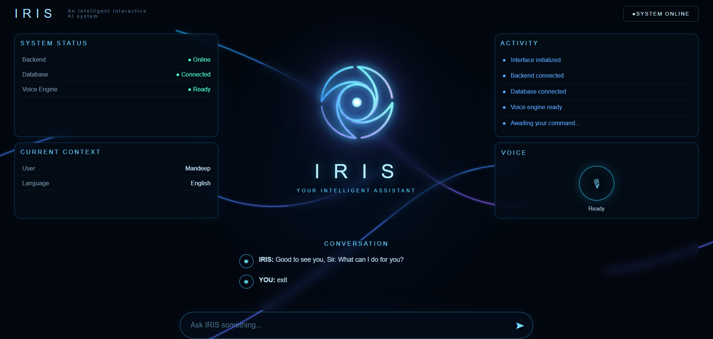
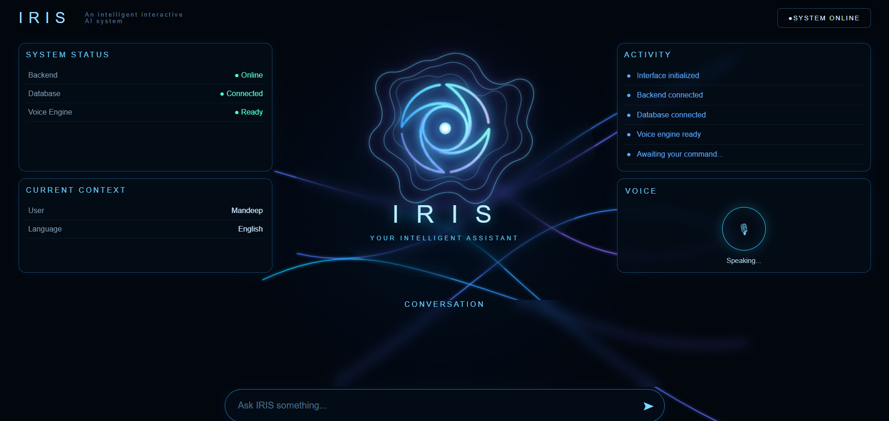
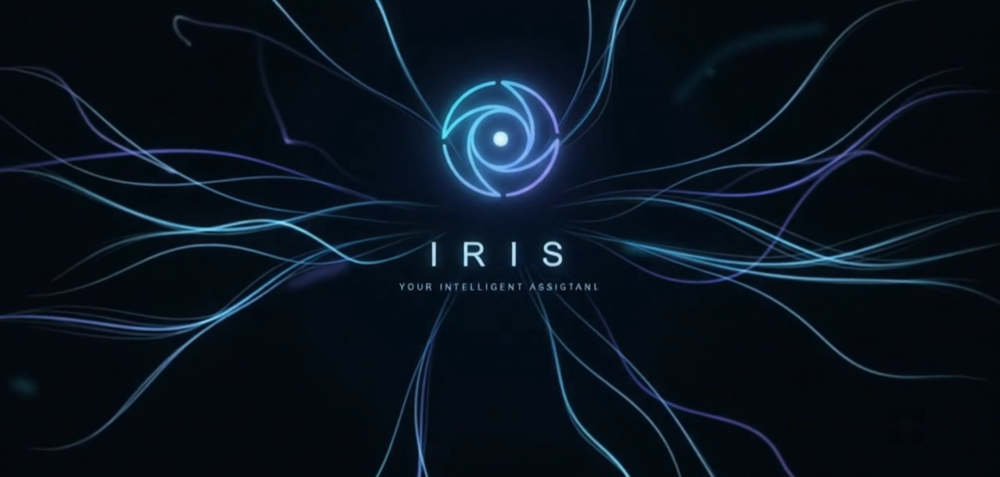
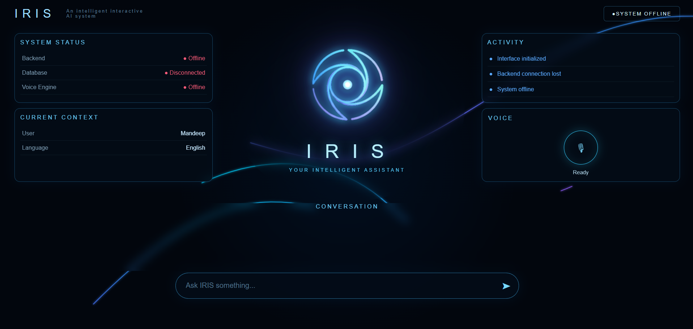

<div align="center">


# IRIS

### Your Personal Assistant

**An intelligent interactive AI system designed to understand, respond, and interact through text and voice.**

<br>



</div>


## ✨ About IRIS

**IRIS** is a personal AI assistant built as a full-stack intelligent system, combining a modern **React frontend**, **Python FastAPI backend**, **MySQL-backed memory**, **voice interaction**, and a **machine learning-based emotion layer** into a unified experience.

The idea behind IRIS is simple:

> **Build an assistant that doesn't just understand what the user says, but also considers the emotional context behind it.**

Phase 2 takes IRIS from a primarily backend-oriented assistant to a connected full-stack application where the **frontend, backend, memory, AI/ML components, command routing, emotion analysis, and voice engine** work together.
---
## 🚀 Phase 2 — What Changed?

Phase 2 focuses on transforming IRIS into a complete **full-stack interactive assistant** by connecting the core assistant logic with a dedicated web interface and supporting services.

Key improvements include:

- 🌐 **React-based frontend** — introduced a dedicated interactive interface for communicating with IRIS.
- ⚡ **FastAPI backend** — established a structured API layer between the frontend and assistant logic.
- 🧩 **Service-based architecture** — connected the frontend to the existing `IrisService` and `Iris.process_command()` workflow.
- 🗄️ **MySQL integration** — connected persistent memory and identity data with the assistant.
- 🎭 **Machine learning emotion layer** — integrated the emotion classification model into the assistant's processing pipeline.
- 🎙️ **Voice integration** — connected speech-to-text and text-to-speech capabilities with the new interface.
- 📡 **Live system awareness** — added dynamic status information for backend, database, and voice components.
- 🖥️ **Interactive visual states** — introduced dedicated UI states for listening, speaking, startup, and system availability.

Together, these changes establish the foundation for IRIS as a connected, interactive personal assistant rather than a standalone backend application.

---

## 🧠 What Makes IRIS Different?

IRIS is designed to go beyond traditional command-based assistants by combining **AI/ML, emotional awareness, memory, voice interaction, and a real-time interface** into a single system.

Its capabilities include:

- 🎭 **Emotion-aware AI** — incorporates an emotion classification model into the assistant's processing pipeline using machine learning, giving IRIS an emotionally-aware layer of interaction.
- 🗄️ **Persistent memory** — uses MySQL to store and retrieve user-related information.
- 💬 **Natural text interaction** — communicate with IRIS through the web interface.
- 🎙️ **Speech-to-text** — interact with IRIS using voice input.
- 🔊 **Text-to-speech** — IRIS can respond through voice.
- 🧩 **Command processing & routing** — routes requests through the appropriate assistant services.
- 📊 **Live system awareness** — the interface reflects the operational state of the backend, database, and voice system.
- 🖥️ **Interactive real-time UI** — the frontend visually reflects what IRIS is currently doing.

The combination of these components forms the foundation for a more **personal, contextual, and emotionally aware assistant**.

---

# 🎭 Emotion & Machine Learning

One of the core ideas behind IRIS is that a personal assistant should understand more than just the literal content of a request.

IRIS integrates a **machine learning-based emotion classification component** into its processing pipeline to identify emotional context from user input.

### 🤖 Emotion Classification Model

IRIS incorporates an **emotion classification model** into its processing pipeline using machine learning.

The model analyzes the user's input to identify its associated emotional context, providing IRIS with an additional layer of information beyond the literal content of the request.

This allows the assistant's processing pipeline to consider both:

- **What the user is saying**
- **The emotional context associated with the input**

The emotion classification component therefore acts as an additional intelligence layer within IRIS, forming the foundation for more emotionally-aware interactions.

The broader interaction flow can be represented as:

```text
                    User Input
                        │
              ┌─────────┴─────────┐
              ▼                   ▼
         Command Analysis    Emotion Analysis
              │                   │
              └─────────┬─────────┘
                        ▼
                 IRIS Processing
                        │
                        ▼
                 Context-Aware
                    Response
                        │
              ┌─────────┴─────────┐
              ▼                   ▼
          Text Response       Voice Response
```

The emotion model provides an additional layer of context that can be used alongside the user's request, memory, and command information.

### Why Emotion Awareness?

Traditional assistants generally focus on:

> **"What did the user ask?"**

IRIS aims to also consider:

> **"What is the user's emotional context while asking it?"**

This creates a foundation for developing interactions that can become more natural, personalized, and context-sensitive over time.

The machine learning component is therefore not treated as an isolated model — it is integrated into the broader assistant architecture.

---

# 🖥️ The IRIS Interface

The Phase 2 interface was designed around a futuristic, minimal dashboard with the IRIS identity at its center.

The dashboard provides visibility into:

- **Backend status**
- **Database connection**
- **Voice engine state**
- **Current user context**
- **Activity history**
- **Conversation state**
- **Voice interaction state**

### Main Dashboard

<div align="center">


</div>

The central IRIS visualization acts as the identity of the system while the surrounding panels expose the current state of the assistant.

---

# 🎙️ Voice Interaction

Voice interaction is one of the major parts of IRIS Phase 2.

The system supports a complete interaction flow:

```text
User Speech
     ↓
Speech-to-Text
     ↓
Command + Emotion Processing
     ↓
Response Generation
     ↓
Text-to-Speech
     ↓
Spoken Response
```

### Listening State

<div align="center">


</div>

When the user speaks, IRIS enters its **listening state**, represented by the normal circular sonar visualization. The assistant is actively receiving and processing the user's voice input.

### Speaking State

<div align="center">



</div>

When IRIS responds through voice, the interface transitions to the **speaking state**, represented by the wavy, flowing circular sonar visualization. This indicates that IRIS is actively generating its spoken response.

---

# 🚀 Startup Experience

IRIS also includes a dedicated startup experience designed to establish the identity of the assistant before the main interface becomes active.

<div align="center">



</div>

The visual design uses flowing light trails, glowing elements, and the IRIS identity to create a consistent futuristic experience across the application.

---

# 📡 System Awareness

A key part of Phase 2 is that the interface is aware of the state of the underlying system.

IRIS can distinguish between states such as:

- Backend online/offline
- Database connected/disconnected
- Voice engine ready/unavailable

For example:

<div align="center">



</div>

This makes the frontend more than a static interface — it acts as a visual representation of the application's runtime state.

---

# 🏗️ Architecture

IRIS Phase 2 follows a layered full-stack architecture:

```text
                    ┌─────────────────────┐
                    │      React UI       │
                    │      Frontend       │
                    └──────────┬──────────┘
                               │
                               ▼
                    ┌─────────────────────┐
                    │      FastAPI        │
                    │       Backend       │
                    └──────────┬──────────┘
                               │
                               ▼
                    ┌─────────────────────┐
                    │    IrisService      │
                    │    Service Layer    │
                    └──────────┬──────────┘
                               │
                               ▼
                    ┌─────────────────────┐
                    │  Iris.process_      │
                    │     command()       │
                    └────────┬────────────┘
                             │
              ┌──────────────┼──────────────┐
              ▼              ▼              ▼
       ┌────────────┐ ┌────────────┐ ┌────────────┐
       │   MySQL    │ │ Emotion ML │ │   Voice    │
       │  Memory &  │ │   Model    │ │ STT / TTS  │
       │  Identity  │ │            │ │            │
       └────────────┘ └────────────┘ └────────────┘
```

### 🔄 Request Flow

A typical interaction follows this path:

```text
User
  ↓
React Frontend
  ↓
FastAPI API
  ↓
IrisService
  ↓
Iris.process_command()
  ↓
Command + Context Processing
  ↓
Emotion / ML Analysis
  ↓
Services / Memory
  ↓
Response
  ↓
Frontend + Voice Output
```

This separation keeps the presentation layer, API layer, assistant logic, machine learning component, memory system, and supporting services modular and easier to maintain.

---

# ⚙️ Technology Stack

### Frontend

- React
- Vite
- JavaScript
- HTML
- CSS

### Backend

- Python
- FastAPI
- Pydantic
- Modular service architecture

### Database

- MySQL
- Persistent memory and identity data

### AI / Machine Learning

- Emotion classification model
- Python-based ML processing
- Emotion-aware interaction pipeline
- Model inference integrated into assistant processing

### Voice

- Speech-to-Text
- Text-to-Speech
- Voice interaction state management

---

# 📁 Project Structure

```text
IRIS-Phase-2/
│
├── backend/
│   ├── api/
│   │   └── routes/
│   ├── app_services/
│   ├── core/
│   ├── ML/
│   ├── MySQL/
│   ├── routing/
│   ├── schemas/
│   ├── services/
│   ├── voice/
│   ├── iris_cli.py
│   └── main.py
│
├── frontend/
│   ├── public/
│   ├── src/
│   ├── package.json
│   └── vite.config.js
│
├── docs/
│   ├── screenshots/
│   │   ├── iris-idle-dashboard.png
│   │   ├── iris-listening-dashboard.png
│   │   ├── iris-speaking-dashboard.png
│   │   ├── iris-startup-dashboard.png
│   │   └── iris-all-system-offline.png
│   │
│   └── iris-logo.png
│
├── requirements.txt
├── .gitignore
└── README.md
```

---

# 🔌 Backend API

The Phase 2 backend exposes API endpoints through FastAPI.

Core endpoints include:

```text
GET  /api/health
POST /api/chat
POST /api/command
```

FastAPI also provides interactive API documentation for development and testing.

---

# 🗄️ Memory & Identity

IRIS uses **MySQL** as its persistent data layer.

This provides the foundation for storing information that can persist beyond a single interaction and enables more personalized assistant behavior.

The memory layer is separated from the higher-level assistant logic, allowing the system to evolve without tightly coupling memory to the user interface.

---

# 🔗 Putting Everything Together

The different components of IRIS work together as a unified interaction pipeline:

```text
                   ┌──────────────┐
                   │     User     │
                   └──────┬───────┘
                          │
                    Text / Voice
                          │
                          ▼
                ┌───────────────────┐
                │   React Frontend  │
                └─────────┬─────────┘
                          │
                          ▼
                ┌───────────────────┐
                │   FastAPI Backend │
                └─────────┬─────────┘
                          │
                          ▼
                ┌───────────────────┐
                │    IrisService    │
                └─────────┬─────────┘
                          │
                 ┌────────┴────────┐
                 ▼                 ▼
          ┌─────────────┐   ┌─────────────┐
          │ Command     │   │ Emotion     │
          │ Processing  │   │ ML Model    │
          └──────┬──────┘   └──────┬──────┘
                 │                 │
                 └────────┬────────┘
                          ▼
                ┌───────────────────┐
                │ Memory / Services │
                │      MySQL        │
                └─────────┬─────────┘
                          │
                          ▼
                ┌───────────────────┐
                │ Response + Voice  │
                └───────────────────┘
```

This architecture allows IRIS to combine **what the user says, the emotional context detected by the ML layer, stored information, and available services** before producing a response.

---

# 🛠️ Getting Started

## 1. Clone the repository

```bash
git clone https://github.com/YOUR-USERNAME/IRIS-Phase-2.git
cd IRIS-Phase-2
```

## 2. Backend Setup

Create a Python virtual environment:

```bash
python -m venv .venv
```

Activate it on Windows:

```bash
.venv\Scripts\activate
```

Install the required Python packages:

```bash
pip install -r requirements.txt
```

## 3. Frontend Setup

Navigate to the frontend:

```bash
cd frontend
```

Install the dependencies:

```bash
npm install
```

## 4. Run IRIS

Start the FastAPI backend and React frontend using the project configuration.

> Configuration such as database credentials, API keys, and other sensitive values should be supplied through environment variables and should never be committed to the repository.

---

# 🔐 Security

Sensitive configuration should never be pushed to GitHub.

Examples include:

- API keys
- Database credentials
- Service credentials
- Private configuration
- Local virtual environments
- Node modules

The repository `.gitignore` is configured to keep local development files and sensitive environment data outside version control.

---

# 🔮 Future Development

IRIS is designed as an evolving personal-assistant platform.

Future development can expand into areas such as:

- 🧠 More intelligent contextual memory
- 🎭 More advanced emotion understanding
- 💬 Improved conversational intelligence
- 🎙️ More natural voice interaction
- 🤖 Improved machine learning capabilities
- 🌐 Additional service integrations
- ⚡ Expanded command capabilities
- 👤 Smarter personalization
- 🖥️ Further UI and visualization improvements

---

# 👨‍💻 Project

<div align="center">

## IRIS

### Your Personal Assistant

**Listen. Understand. Respond.**

Built with Python, React, FastAPI, MySQL, AI/ML, APIs, voice technology, and a lot of late-night debugging. 🚀

</div>
